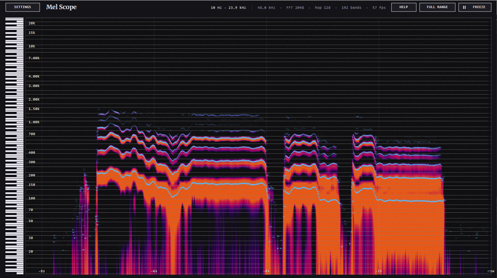
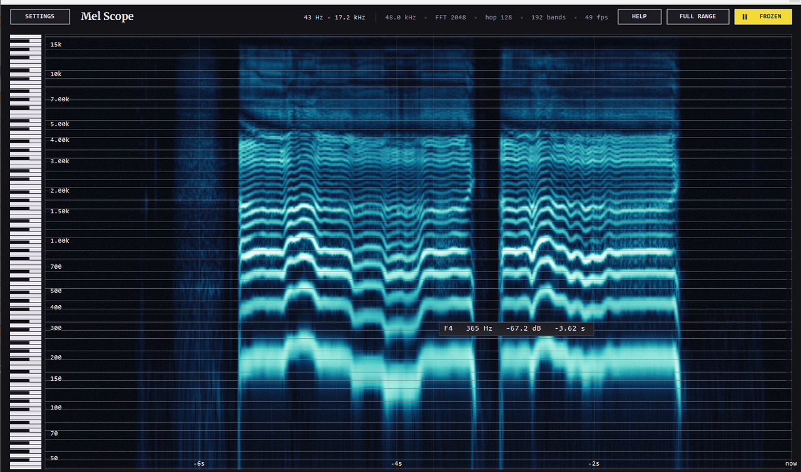
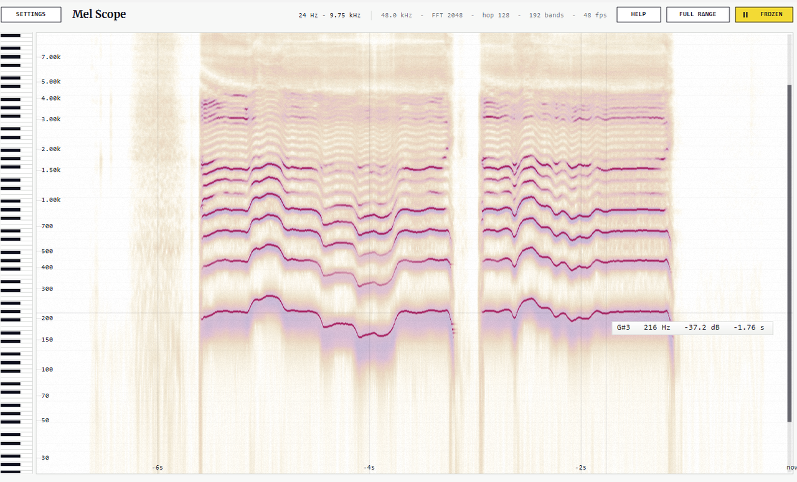
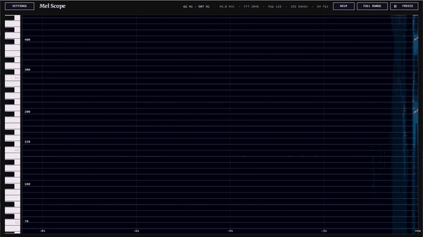

# Mel Scope

A real-time mel spectrogram and harmonic-trace display, as an audio effect plugin for
**CLAP** and **VST3** on Windows x64. It passes audio through bit-exactly and only
listens.



Pitched material is traced as a stack of thin harmonic lines over a dimmed mel
spectrum, so pitch movement reads at a glance; unpitched detail still shows up as the
wash underneath. Every control is also exposed as a plugin parameter, so it can be
automated and is saved with the project.

## Screenshots

| | |
| --- | --- |
|  |  |
| Frozen, with the hover readout | Light theme, Sand colormap |



## Install

Prebuilt binaries are not committed; build them from source (below) and they land in
`dist/`:

* **CLAP** - `dist/MelScope.clap`, a single self-contained file. Copy it into your CLAP
  plugin folder, or point the host's plugin scan at `dist/`.
* **VST3** - `dist/MelScope.vst3`, a bundle. Copy the whole folder into your VST3
  folder (`%COMMONPROGRAMFILES%\VST3` is the system one) and rescan.

Any host with CLAP or VST3 support should load it; it is an insert effect with one
stereo input and output. Requirements: Windows 10/11 x64, no runtime DLLs (static C++
runtime), no installer.

## What it shows

**Display = Harmonics** (default) is the intended view for a vocal or any single
pitched source. The analyser finds spectral *peaks* (local maxima in dB, each refined
with a parabola across its three bins), keeps the ones within 30 dB of the frame's
loudest peak, and draws them on the pitch axis as lines a few pixels thick. Underneath
sits the ordinary mel spectrum at roughly a third of the brightness, so breaths, noise
and consonants still show as context.

Each colormap carries its own **peak ink** - a complementary colour rather than the hot
end of the gradient - so the traced lines read as an overlay on the wash. The ink is
composited after the bloom, so Glow softens the background without ever touching the
lines.

The ink is chosen per map, not derived from the map's own hue: it is the colour
furthest from every stop of that ramp (and from its dimmed wash), measured as
worst-case CIE76 distance. Turbo and Cividis contain every hue, so a complement lands
inside the ramp and disappears; they carry hand-picked magenta inks (worst-case dE 69
and 78, up from 23 and 43). The light maps keep inks chosen to read as ink on paper and
to stay in key with the ramp beneath: raspberry (Paper), aubergine (Sand), raspberry
pink (Bloom) and vermilion orange (Ink).

The wash behind the traces is deliberately short-range: a gamma-2 falloff capped at
42 % of the ramp, so silence really is paper and quiet detail only tints it faintly.
Peak lines are not affected by that curve.

**Display = Spectrum** draws the plain mel spectrogram with no peak tracing, for
general material where you want everything at once.

The piano ruler on the left is drawn through the *same* frequency mapping as the image,
so its keys line up with the rows: with **Frequency axis = Mel** the low octaves
compress with the image (keys thinner than ~3 px merge into a solid block); with
**Log** the keys are evenly spaced semitones. The horizontal lines mark each key's
centre, blended toward the inverse colour so they stay visible over both the canvas and
the brightest parts of the picture, and decimated when octaves get too dense to read.
While they are on, the frequency labels shrink to short ticks, which would otherwise
draw a second, competing grid at arbitrary frequencies.

## Controls (Settings button, top left)

| Group | Control | Default | Notes |
| --- | --- | --- | --- |
| Analysis | FFT size | 8192 | 2048 - 16384; larger is sharper in frequency, smaller smears the mel bands into bars by keeping whole bins |
| | Overlap | 87.5 % | 50 / 75 / 87.5 / 93.75 %; sets columns per second |
| | Mel bands | 192 | vertical resolution of the mel filterbank |
| | Window | Hann | Hann / Blackman-Harris / Hamming / Rect |
| | Input | Mix | Mix / Left / Right; mono or stereo input both work |
| Range | Low cut | 30 Hz | lowest frequency shown |
| | High cut | 1.5 kHz | highest frequency analysed, clamped to Nyquist. Changing it rebuilds the bank; Ctrl+wheel only moves the view inside it |
| | Spectrum range | 120 dB | dynamic range of the spectrum image below the ceiling |
| | Peak range | 60 dB | dynamic range of the peak traces, counted down from the ceiling; independent of Spectrum range, and greyed out in Spectrum display |
| | Ceiling | +6 dB | top of the colour scale when Auto level is off |
| | Auto level | Off | ceiling follows the loudest band (0 dB = full-scale sine) |
| View | Time span | 9.15 s | history across the width; the wheel over the plot zooms it |
| | Display | Harmonics | Harmonics / Spectrum |
| | Theme | Light | Light / Dark; the canvas follows, and a light-only map is swapped for Ember |
| | Frequency axis | Log | Mel / Log / Linear |
| | Colormap | Ice | follows the theme: dark offers Ember, Inferno, Magma, Plasma, Viridis, Turbo, Cividis; light offers Ice, Paper, Sand, Bloom, Ink |
| | Gamma | 0.96 | mid-tone brightness |
| | Tilt | -1.9 dB/oct | spectral tilt around 1 kHz |
| | Glow | 0 % | soft bloom on the wash only - peak lines are never blurred |
| | Grain | 20 % | paper texture: fine stable noise over the image |
| | Smoothing | 6 % | temporal averaging between frames |
| | Key guides | 13 % | strength of the piano-key centre lines (0 = off) |
| | Peak range | 60 dB | see the Range group |
| | Freeze | Off | hold the picture (double-click the plot also toggles it) |
| | UI scale | 115 % | size of the text and controls, in percent of the host's scale; the window opens at this size too |

The panel is a drawer that opens from the left edge; the wheel scrolls it when the
window is short. The header carries the two things you reach for constantly, so neither
is buried in a menu: **Full range** resets Low cut / High cut to the whole spectrum
(the parameter minimum up to the Nyquist limit of the current sample rate) and confirms
the new range in the subtitle; **Freeze** holds the image. It also drops any vertical
zoom, so the picture returns to the whole band.

Mouse: drag a row to change it, double-click resets it, click a row with a chevron for
its menu, click a value to type a number. Wheel over the plot zooms the time span,
**Ctrl+wheel zooms the frequency axis around the pointer** (the frequency under the
cursor stays under it), Shift+wheel changes the spectrum range.

While zoomed, **drag anywhere over the plot** (outside the open panel) to pan up and
down; a slim bar on the right edge shows where the view sits, and double-clicking it
zooms back out. Zooming out widens the analysed range when it reaches the edge (the mel
bank is rebuilt, so the history clears once) instead of stopping silently at the current
High cut. Esc closes the panel.

The same frequency zoom works with **no modifier at all when the wheel is over the piano
keyboard** on the left - a fallback for hosts that claim Ctrl for themselves. A plain
Alt press is swallowed, so the window never enters the Windows menu loop (which holds
the keyboard capture and hides modifier state until Alt is tapped again).

## The readout

Under the pointer: the note the frequency belongs to, the frequency, the level and the
time relative to the right edge. The note is the *nearest* semitone, not the one below -
a note's region runs ﾂｱ50 cents around its centre, so 216 Hz reads `A3 -35c` and 213 Hz
reads `G#3 +46c`. The cents figure is the distance from that centre, which is what tells
you how sharp or flat a sung note is. Within half a cent of the centre the suffix is
dropped.

The readout sits on an opaque plate that follows the pointer, so guide lines never show
through the numbers and it cannot collide with the axis labels.

## Freeze

Freeze holds the image and the interface stays live: every display parameter (gamma,
tilt, glow, grain, key guides, colormap, axis, theme, time span, ranges, ceiling, auto
level) still applies to the held image immediately.

The hold is real, not a paused clock: the analysis thread stops consuming audio while
frozen, so the frame ring cannot overwrite the window being held. Unfreezing drops the
held history and starts streaming again, so the gap does not appear as a jump in the
timeline.

The parameters that would rebuild the mel filterbank - **FFT size, Overlap, Mel bands,
Window, Low cut, High cut, Smoothing** - are greyed out while frozen, because applying
them would discard the image being held. They stay deferred rather than lost: change
them from a preset or by automation and they apply on unfreeze.

## Saving and loading

Bottom of the panel:

* **Save preset** writes every parameter as key=value through a normal file dialog, and
  shows the chosen path in the header for a few seconds.
* **Load preset** opens the same dialog and applies the file.
* **Reset all** restores the built-in defaults, **Clear** empties the history.

Separately, and without any dialog, every parameter is written on exit to
`%APPDATA%\MelScope\settings.ini` (falling back to `%LOCALAPPDATA%\MelScope\`, then next
to the plugin), so a new instance starts where you left off. A project's saved state
still wins over that global file.

The plugin state blob is the same format in both shells, so a project can be moved
between the CLAP and VST3 builds.

## Theme

The chrome uses the paper/ink design tokens directly (constants at the top of
`src/Gui.cpp`):

| token | light | dark |
| --- | --- | --- |
| background | `#f8f9f8` | `#131318` |
| surface | `#ffffff` | `#1c1c22` |
| surface-muted | `#f4f1ec` | `#26262e` |
| foreground | `#0d0e1c` | `#e9e7f1` |
| muted | `#706b65` | `#9a97a8` |
| border | `#d6d7d6` | `#32323c` |
| accent | `#0d0e1c` | `#ff8a4c` |
| success | `#5d8f5a` | `#86c084` |

The canvas follows the theme, and everything drawn on it (rules, labels, crosshair,
readout) flips its ink automatically: the renderer looks at the colormap's darkest entry
and picks dark ink with a white halo on the light maps, or light ink with a black shadow
on the dark ones. Switching between a light and a dark map therefore keeps the plot
readable either way.

Each theme owns its gradients and the Colormap menu only lists that theme's set; every
light gradient starts at pure white, so the quietest thing on screen is the canvas
itself, and the first slice of every ramp eases out of the canvas colour so the
background never meets the colours in a visible step.

## UI scale

At the bottom of the View group. It multiplies the host's DPI scale, defaults to 115 %,
and sizes the window as well as the chrome - so a dense display gets bigger text rather
than a bigger spectrogram only. The parameter is stepped in whole percent and can be
typed as well as dragged.

## FFT size

Only 2048 - 16384 is offered. Below 2048 the bin width (23 Hz at 48 kHz) is wider than
the mel bands in the low range, so several bands fall on one bin and the image breaks
into horizontal bars; with a 1.5 kHz high cut a 32768 window buys nothing either.

## Sample rates, mono and stereo

The analyser is mono internally and the display is sample-rate independent:

* mono input is copied straight in; stereo is downmixed, or L/R selected with **Input**;
* tested at 22.05 / 32 / 44.1 / 48 / 88.2 / 96 / 192 kHz;
* **High cut** is clamped to Nyquist, so it never asks for bins that do not exist.

Audio is never modified: the output is a bit-exact copy of the input.

## Building from source

Windows x64, MinGW-w64 GCC. No CMake, no JUCE, no MSVC. The project is plain C++17:
Win32 + GDI+ for the UI, one FFT + mel filterbank + peak tracer for the DSP, and the
CLAP / VST3 ABIs as the shells.

Download the toolchain into `_tools/` (it is not versioned):

```
_tools/mingw64/                 MinGW-w64 GCC
_tools/clap/include/            CLAP headers  (https://github.com/free-audio/clap)
```

Then:

```
powershell -ExecutionPolicy Bypass -File build.ps1
```

The `-ExecutionPolicy Bypass` is only needed because Windows blocks unsigned scripts by
default.

| File | What |
| --- | --- |
| `src/MelCore.h/.cpp` | FFT, mel filterbank, frame store, peak tracer, renderers |
| `src/Colormaps.h` | generated 256-entry colour tables (`tools/make_colormaps.py`) |
| `src/Plugin.h/.cpp` | shared `App` (parameters, engine, settings) + CLAP shell |
| `src/Gui.h/.cpp` | Win32/GDI+ editor: plot, piano ruler, panel, dropdowns, help |
| `offline/melrender.cpp` | WAV to image through the same analyser |
| `offline/selftest.cpp` | sample-rate / mapping / FFT-size checks |
| `hosttest/main.cpp` | loads the .clap like a host: ABI, audio, state, GUI |
| `vst3/Vst3Plugin.cpp` | VST3 shell: same engine and editor behind the SDK's single-component model |
| `vst3/Vst3Entry.cpp` | module entry and class registration |
| `vst3/Vst3HostTest.cpp` | loads the .vst3 like a host: factory, audio, state, parameters, editor pixels |
| `vst3/build-vst3.ps1` | builds `dist/MelScope.vst3` |

## VST3 build

```
powershell -ExecutionPolicy Bypass -File vst3/build-vst3.ps1 -RunTests
```

Needs the VST3 SDK in `_tools/` as well:

```
git clone --depth 1 --recurse-submodules --shallow-submodules `
    https://github.com/steinbergmedia/vst3sdk.git _tools/vst3sdk
```

The wrapper is written straight against the VST3 interfaces rather than through a
framework: JUCE 8 refuses MinGW (`#error "MinGW is not supported"`), so the shell owns a
`melscope::App`, mirrors its parameters through the VST3 parameter API, and embeds the
existing Win32 window inside the HWND the host passes to `IPlugView::attached`. Only a
handful of SDK support files are compiled.

Two deliberate differences from the CLAP build: the VST3 view reports that it can resize
but does not negotiate a host layout beyond its own size request, and there is no
`moduleinfo.json`, so hosts fall back to reading the DLL's factory directly.

## Verification

```
build\selftest.exe                        # DSP across sample rates and FFT sizes
build\hosttest.exe build\MelScope.clap    # ABI, parameters, pass-through, state, GUI
build\melrender.exe in.wav out.ppm ...     # render a file through the same code path
```

`selftest` covers 22.05-192 kHz: the traced peak lands within 0.5 % of the input tone at
every rate, the frame clock tracks `hop / sr`, and every FFT size x band count analyses
a 500 Hz tone correctly.

The VST3 script builds a host-side test too (`build-vst3/vst3test.exe`), which loads the
bundle, enumerates the factory, instantiates through `IComponent`, checks the parameters,
processes audio, round-trips the state, and creates the editor window - then reads the
client area back to prove it actually painted something.

## Repository layout

Tracked: source, docs and the generator scripts. Ignored: `build/`, `dist/` (compiled
output), `_tools/` (toolchain and SDKs) and `_analysis/` (scratch captures). A fresh
clone therefore needs the toolchain downloaded before either build script will run.

## License

This project's own code is released under **0BSD** - see `LICENSE`, which is the most
permissive licence available: no attribution, no conditions, no warranty.

Two caveats are worth knowing before you redistribute binaries, and both are set out in
`THIRD-PARTY.md`:

* the embedded **Merriweather** font is SIL OFL 1.1, which requires its licence to
  travel with the binary (`licences/OFL-1.1.txt`), and the **CLAP** headers are MIT;
* a compiled **VST3 build** contains files from the Steinberg VST3 SDK, which is GPLv3
  or a proprietary Steinberg licence. Distributing a VST3 binary therefore carries the
  SDK's terms rather than 0BSD. The CLAP build depends on no such code.
